# Intelligent Agent Architecture

```mermaid
flowchart LR
    A["Raw Kaggle/ULB CSV"] --> B["Schema and quality validation"]
    B --> C["Leakage-safe train/validation/test split"]
    C --> D["Sklearn preprocessing pipelines"]
    D --> E["Course-aligned model comparison"]
    E --> F["Probability calibration where needed"]
    F --> G["Validation fraud probabilities"]
    G --> H["Genetic Algorithm threshold optimizer"]
    H --> I["Frozen thresholds"]
    F --> J["Locked test probabilities"]
    I --> K["Three-action decision policy"]
    J --> K
    K --> L["Operational cost and explanation"]
    L --> M["Reports, figures, Streamlit demo"]
```

The novelty is the decision architecture: calibrated probability estimates are converted into three operational actions using Genetic Algorithm thresholds optimized for asymmetric, amount-aware costs and a review-capacity constraint.

